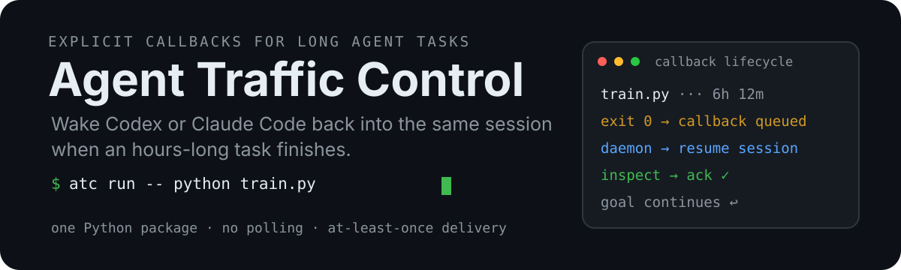
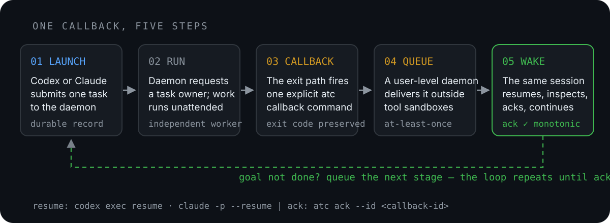

<p align="center">
  
</p>

<h3 align="center">ATC (Agent Traffic Control): dispatch work to any agent and route the result back to the session that asked.</h3>

<p align="center">
  <a href="./CHANGELOG.md"></a>
  <a href="https://www.npmjs.com/package/agent-atc"></a>
  
  
  
  <a href="./LICENSE"></a>
</p>

<p align="center">
  <a href="#-quick-start">Quick start</a> ·
  <a href="#-how-it-works">How it works</a> ·
  <a href="#-usage">Usage</a> ·
  <a href="#-documentation">Docs</a> ·
  <a href="./README.zh-CN.md">中文</a>
</p>

---

## The problem

You ask Codex or Claude Code to train a model, run a benchmark, or hand a review to a second agent.
The work takes two hours. Now what?

- The agent **polls** with `sleep && tail`, burning turns, tokens and context on nothing.
- Or the job is **owned by the agent's shell**, so it dies when the turn ends, times out, or the app restarts.
- Or the second agent's answer lands somewhere else, and **you carry it back** to the conversation by hand.

## The fix

**ATC** hands the work, a command or a fresh agent in any harness, to an independent OS-native
process owner. When it finishes, ATC **resumes the exact same conversation** with a short result:
what it observed, what a child agent reported, where the files are, and the command to acknowledge it.

```console
$ atc run --task "train model" -- python train.py --config configs/exp.yaml
atc: submitted managed task <task-id>
atc: execution backend: systemd
...
```

The agent ends its turn — zero model calls while it waits. Two hours later, the **same session**
receives a short envelope like this:

```text
[atc] <task-id>-c1
Task: train model
Result: exited 0 · 2h 3m 32s
From: run on systemd-user
Files: ~/.atc/tasks/<task-id>/ (attempt-1.log)
Details: .../details/<task-id>-c1.md (as needed)
Session: <session-id> (only)
ACK after inspection: atc ack <task-id>-c1
```

## Why more than one harness?

Subscriptions are the cheapest way to use frontier models, and they come tied to a harness. A Claude
plan gives you Claude models inside Claude Code; a ChatGPT plan gives you OpenAI models inside Codex.
That quota generally can't be pointed at another tool, and each of these harnesses is built around its
own vendor's models.

Open harnesses such as Pi work the other way around. They run whatever model you give them: an API key
from any provider, an open-weight model on your own GPU, or a cheap fast model for routine steps.

Real work rarely fits one model. Writing, coding, reviewing and long experiments each have a model that
does them best or most cheaply, and models keep getting more specialized. Using the right one for each
job means running several harnesses side by side, some closed and some open. None of them knows the
others exist: a Codex session can't hand a task to Claude Code and get the answer back, and a Pi agent
can't report to either.

This project fills that gap. From a Codex, Claude Code or Pi session, `atc agent codex|claude|pi`
starts a fresh agent in any of the three as a durable job, and the result comes back to the session that
asked for it. A single dispatch layer across closed and open harnesses is also why Long Task Callback
became **Agent Traffic Control**.

## ✨ Highlights

| | |
| --- | --- |
| 🛌 **No polling** | The worker and daemon wait for you. No model turns are spent while the task runs. |
| 🔁 **Same conversation** | Callbacks are bound to the original Codex (`CODEX_THREAD_ID`) or Claude Code (`CLAUDE_CODE_SESSION_ID`) session — never a guess. |
| 🧱 **Survives the agent** | Tasks run under systemd, launchd or Task Scheduler — not as a child of the agent turn or even the daemon. |
| ⚡ **Claude Code native** | In Claude Code (CLI or desktop app), a background `atc wait` wakes the conversation you're looking at — no headless side session. → [Claude Code guide](docs/claude-code.md) |
| 🥧 **Pi native** | Pi's extension steers the result into the running Pi session — even mid-run, before its next model call. → [Pi guide](docs/pi.md) |
| 🤖 **Any agent, any harness** | `atc agent codex\|claude\|pi` starts a fresh agent as a durable job from any of the three. It writes a structured report, shown to you as a claim, never as proof. |
| 📦 **One installation** | `atc setup` installs one canonical `~/.atc/bin/atc`; copies of `atc` in other environments forward to it, so versions never mix. |
| 🎯 **Multi-stage goals** | Track an objective across many callbacks with a YAML plan that the agent must verify before declaring victory. |
| 🛡️ **Never reruns blindly** | Ambiguous launches, reboots and failures are reported to the agent for inspection — ATC never silently replays work. |
| 🩺 **Self-repairing setup** | When something is misconfigured, the agent gets a machine-readable repair plan and fixes it itself. |
| 📬 **At-least-once delivery** | Durable queue, stable callback IDs, retries with backoff, and explicit ACKs. |

## 🚀 Quick start

> The npm package is not published yet (the name holds a 0.0.0 placeholder). Until it is, install
> it from GitHub with the `pip` command below.

```bash
# 1. Install (prebuilt for Linux x64; see below for other platforms)
npm install -g agent-atc

# 2. Make it the installed ATC, add the skills for Codex + Claude Code, start the coordinator
atc setup --force --enable --now
#    Using Pi too? Add --with-pi-extension (Pi skill + live-callback extension)

# 3. Check that everything is healthy
atc --version
atc doctor --agent codex --session <session-id>
```

Without Node, or on macOS and Windows until their prebuilt packages ship, install from source and
run the same `atc setup`:

```bash
python3 -m pip install "git+https://github.com/lz59970062/agent-atc.git"
```

That's it. `setup` installs the bundled skill, so your agent already knows when and how to use `atc`.
From inside a Codex or Claude Code session, just ask it to run something long.

<details>
<summary><b>Platform requirements</b></summary>

| Platform | Task owner | Coordinator | Notes |
| --- | --- | --- | --- |
| **Linux** | Independent systemd user service (v240+) | systemd user service | Falls back to GNU `screen` when no user systemd is available (e.g. Docker, AutoDL). See [containers](docs/containers.md). |
| **macOS** | One-shot launchd job in the GUI session | LaunchAgent | No `screen` needed. See [macOS guide](docs/macos.md). |
| **Windows 10+** | Per-user Task Scheduler task + Job Object | Login scheduled task | Requires a logged-in session and an ACL-capable filesystem (NTFS). See [Windows guide](docs/windows.md). |

The backend is recorded when a task is submitted and is never silently changed during recovery.
To use the screen compatibility backend: `sudo apt install screen` (or `dnf install screen`), then
`atc run --backend screen ...`.

</details>

<details>
<summary><b>Codex Desktop callbacks</b></summary>

Callback modes are explicit (`cli`, `desktop`, `manual`, `auto`), and `atc setup` generates a Desktop
launcher on Mac and Windows. Setup never starts or interrupts Desktop. When you're ready, quit
Desktop and open `Start ATC Desktop.command` (Mac) / `Start ATC Desktop.cmd` (Windows), or run
`atc desktop launch`. Read [callback modes](docs/callback-modes.md), [Mac Desktop setup](docs/macos-desktop-bridge.md)
and [Windows Desktop setup](docs/windows-desktop-bridge.md) for the current limits; the Windows Desktop
package-context bridge is still experimental.

</details>

### Coming from Long Task Callback (`ltc`)

ATC does not read LTC's records. Move over in one explicit step:

```bash
atc migrate            # shows what would change; changes nothing
atc migrate --apply    # archives ~/.ltc, removes the old service, skills and hooks
atc setup --force --enable --now
```

`atc migrate` refuses while LTC still has callbacks to deliver or tasks running; add `--wait`
to let the old daemon finish them first. The LTC state directory is renamed, never deleted.

## 🧭 How it works

<p align="center">
  
</p>

```text
systemd user service (Linux) / LaunchAgent (macOS) / login scheduled task (Windows)
  └─ atc daemon                 control, recovery and callback delivery

Independent per-task service (screen for legacy tasks)
  └─ ATC worker
      └─ training / benchmark / build / child agent
```

1. **Submit** — the agent calls `atc run` or `atc agent`. ATC durably records the command, environment,
   original session binding, backend and log path, then returns immediately.
2. **Own** — the daemon asks the OS for a separate task service. The task is *not* a child of the agent or the daemon.
3. **Run** — the job runs for minutes or hours. Nobody polls.
4. **Queue** — on exit, ATC stores the result and queues a callback for the original conversation.
5. **Resume** — the same session wakes up, inspects the result, and runs `atc ack`.

> **Rule of thumb:** anything reliably done in under 60 seconds can run in the foreground.
> Anything longer — or of uncertain duration — goes through `atc run`.

## 📖 Usage

ATC has three entry points:

| Command | Use it when… |
| --- | --- |
| `atc run -- <command>` | You want ATC to **launch and own** a new long task. |
| `atc agent codex\|claude\|pi -- <prompt>` | You want a **fresh child agent** to work in the background and report back. |
| `atc done ...` | The task is **already owned** by screen, tmux, Slurm or another scheduler — just report completion. |

### `run` — submit a long task

```bash
atc run \
  --cwd "$PWD" \
  --task "train model" \
  -- python train.py --config configs/exp.yaml
```

Returns as soon as the task is durable, printing the task ID, backend and log file:

```bash
tail -f ~/.atc/tasks/<task-id>/attempt-1.log
```

### Claude Code: wake the live session

Claude Code wakes a session when a background shell command exits. After `atc run`, it prints the
exact command to run with `run_in_background`:

```bash
atc wait --queue-dir ~/.atc/queue --task <task-id>
```

`atc wait` exits — and the session wakes up — as soon as the callback is queued. While a waiter is
alive the daemon stays out of the way; if the session is gone, the daemon falls back to a headless
`claude -p --resume` from the session's original directory. The installed Claude skill teaches
Claude to do this on its own. → [Claude Code guide](docs/claude-code.md)

### `agent` — delegate to a background child agent

```bash
atc agent claude --cwd "$PWD" --task "review parser edge cases" \
  -- "Inspect parser.py and its tests. Report concrete defects and suggested fixes."

atc agent codex --template test --task "write parser tests" \
  -- "Use docs/parser-contract.md to test parser.py, including invalid input and boundaries."
```

The child gets its own private prompt/result files; the callback still goes to *your* conversation.
Use `--template` / `--template-file` for reusable prompts, `--model` / `--reasoning-effort` to pin
the child's model, and `--dry-run` to preview. → [Agent mode & templates](docs/agent-mode.md)

### `done` — report an externally managed task

```bash
set +e
python train.py --config configs/exp.yaml
status=$?
atc done --cwd "$PWD" --task "train model" \
  --command "python train.py --config configs/exp.yaml" --exit-code "$status"
exit "$status"
```

Drop this into a screen/tmux session, Slurm epilogue, shell trap or Python `finally`. `done` only
queues the callback — it doesn't make the preceding process durable.

### Acknowledge, inspect, cancel

```bash
atc wait --task <task-id>         # (Claude Code) block until the callback is ready, then print it
atc ack <callback-id>        # confirm a callback was received and inspected
atc status                        # list callbacks that still need handling
atc cancel --id <callback-id>     # cancel a queued callback
atc retry --id <callback-id>      # re-deliver a result without rerunning the task
atc doctor --agent codex --session <id>   # JSON readiness report + repair plan
```

### Multi-stage goals

Callback ACK says *"I saw this result."* Goal ACK says *"the whole objective is done (or blocked)."*

```bash
atc goal start --id report-goal --session <session-id> --cwd "$PWD" \
  --task "finish the report" --plan-file .atc/goals/report-goal.yaml
atc goal check --id report-goal
atc goal ack --id report-goal --state completed --plan-sha256 <checked-sha256>
```

The plan is an editable YAML path of steps. Completion is rejected unless every step is `completed`
and the digest matches a fresh `goal check`. Idle goals get a status nudge every three hours.
→ [Goals guide](docs/goals.md)

### Session binding

Inside an agent conversation, ATC binds automatically via `CODEX_THREAD_ID` (Codex) or
`CLAUDE_CODE_SESSION_ID` (Claude Code). You can also bind explicitly:

```bash
atc done --agent claude --session <session-id> --cwd "$PWD" --task "external job" --exit-code 0
```

If no target can be determined, ATC fails instead of guessing; there is no "most recent session" fallback.

## 🔒 Guarantees and boundaries

- **At-least-once delivery.** Unacknowledged callbacks retry with backoff. After a host failure a callback
  may arrive twice, so resumed agents inspect existing processes and artifacts before acting.
- **No blind reruns.** After a reboot, ATC wakes the original session with the task, log path and
  interruption reason — the agent decides whether to resume from a checkpoint. There is no `--resume-command`.
- **No cross-host recovery.** ATC does not move workspaces, data, checkpoints or credentials between machines.
- **Private state.** Everything lives under `${ATC_HOME:-~/.atc}/`; full callback
  details are saved privately in `details/<callback-id>.md`. An older
  `~/.codex/agent-atc/` is moved there on first run and left as a symlink.

More in [recovery & self-repair](docs/recovery.md) and [architecture](docs/architecture.md).

<details>
<summary><b>Upgrading from 0.6</b></summary>

Drain existing work and upgrade the coordinator before submitting native tasks, or use a separate 0.7
queue and Agent profile — the 0.6 daemon does not understand native task records. Pass the same
`--queue-dir /absolute/path/to/atc-queue` to `atc daemon`, `atc run` and `atc ack`. Standalone
coordinators also need separate `CODEX_HOME` profiles. The submitting shell must carry the original
Agent session ID (or pass `--session`). Old scripts may still pass `--via-daemon`; it is a hidden no-op.

</details>

<details>
<summary><b>Service management</b></summary>

```bash
# Linux
systemctl --user status agent-atc.service
journalctl --user -u agent-atc.service -f
# macOS
launchctl print "gui/$(id -u)/agent-atc"
```

`atc setup --service auto` picks systemd (Linux), launchd (macOS) or `windows-task` (Windows).
Use `--service standalone --now` where user systemd is unavailable (e.g. AutoDL), or
`--service supervisor` explicitly. Standalone setup does not register startup on its own — see
[containers](docs/containers.md) for boot hooks, Supervisor and Docker restart policies.

</details>

## 📚 Documentation

[中文文档站](https://lz59970062.github.io/agent-atc/) · [文档源码](docs/index.md)

| Topic | |
| --- | --- |
| Claude Code: live callbacks, binary discovery, session directories | [docs/claude-code.md](docs/claude-code.md) |
| Pi: steered live callbacks, managed sessions, Pi child agents | [docs/pi.md](docs/pi.md) |
| Agent mode, templates, Claude Code config | [docs/agent-mode.md](docs/agent-mode.md) |
| Registering templates as discoverable skills | [docs/template-registration.md](docs/template-registration.md) |
| Goals and acknowledgement layers | [docs/goals.md](docs/goals.md) |
| Callback format, reminder cadence, user hook | [docs/callback-reminders.md](docs/callback-reminders.md) |
| Callback modes (CLI / Desktop / manual) | [docs/callback-modes.md](docs/callback-modes.md) |
| Restart, recovery and self-repair | [docs/recovery.md](docs/recovery.md) |
| Protocol v1 and package architecture (design) | [protocol](docs/design/protocol-v1.md) · [architecture](docs/design/architecture.md) |
| Platform ownership and extension points | [docs/architecture.md](docs/architecture.md) |
| macOS · Windows · Containers | [macOS](docs/macos.md) · [Windows](docs/windows.md) · [Containers](docs/containers.md) |
| Desktop bridges | [Mac](docs/macos-desktop-bridge.md) · [Windows](docs/windows-desktop-bridge.md) |
| Validation records | [0.8.0.dev0 Linux in Docker](docs/validation-0.8.0-docker.md) |
| Validation records (Long Task Callback era) | [0.7.0](docs/validation-0.7.0.md) · [0.7.1 preview](docs/validation-0.7.1-preview.md) · [Linux preview](docs/validation-0.7.0a1.md) · [macOS](docs/validation-macos.md) · [Windows](docs/validation-windows.md) |
| Release history | [CHANGELOG.md](CHANGELOG.md) |

## 🗺️ Roadmap

- [x] Native task owners on Linux, macOS and Windows
- [x] Fresh child agents in Codex, Claude Code and Pi; live callbacks into Claude Code and Pi
- [x] Protocol v1: root-plus-suffix IDs, record schemas, delivery capabilities, results that keep child reports apart from observed facts (0.8)
- [x] One canonical installation and npm distribution for Linux x64 (0.8)
- [ ] Prebuilt npm packages for macOS and Windows
- [ ] `--notify`: deliver a callback to another session
- [ ] Expert agents, and forking an expert's context from a checkpoint
- [ ] Fan-in: one callback when a group of tasks finishes
- [ ] More harnesses: Gemini CLI, OpenCode, and agents that speak ACP
- [ ] A cross-harness benchmark against working without ATC

## License

[MIT](LICENSE) · ATC was previously Long Task Callback (`ltc`); see [Coming from Long Task Callback](#coming-from-long-task-callback-ltc).
